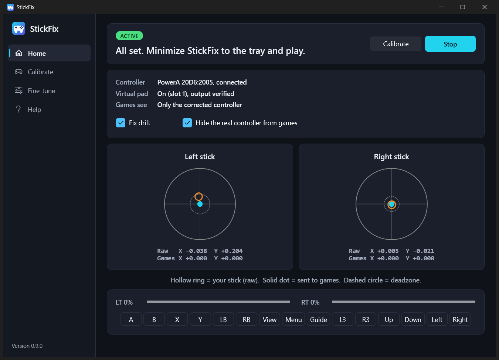

<p align="center">
  
</p>
<h1 align="center">StickFix</h1>
<p align="center">Fix controller stick drift on Windows, without opening your controller.</p>



StickFix measures where your sticks really rest, removes the offset, and gives games a corrected virtual Xbox
controller while hiding the real one. It runs quietly in the system tray while you play.

Software can fix a stick that rests off-center. It can't repair a worn one, and StickFix tells you which you have.

## Install

1. Download `StickFix-Setup` from the [Releases page](https://github.com/Arshadsahabdeen/Gamepad-Stickdrift-Corrector/releases). If there's no release yet, [build it yourself](#build-from-source).
2. Run it. Keep both driver checkboxes ticked unless you already have them: **ViGEmBus** creates the virtual
   controller and **HidHide** hides the real one. Each opens its own setup window.
3. Restart if asked.

Needs 64-bit Windows 10 or 11. You don't need to install .NET or anything else.

> **The installer isn't code-signed yet.** SmartScreen will warn you (choose *More info*, then *Run anyway*), and
> Windows 11 Smart App Control may block it outright. Only install it if you trust this repository.

## Use

1. Plug in your controller and open StickFix.
2. Go to **Calibrate** and follow the steps. It takes about 25 seconds, and shows you the result before saving.
3. On **Home**, tick **Hide the real controller from games**.
4. Minimize StickFix. It moves to the system tray and keeps working.
5. Start your game **after** StickFix. A game that's already running keeps its connection to the real controller.

Double-click the tray icon to reopen it, or right-click for **Fix drift** and **Exit**. Closing the window with X
exits StickFix and gives your real controller back.

**Something wrong?** Go to **Help > Restore my controller**. Your controller also comes back automatically if
StickFix closes or crashes, and at your next sign-in if the PC loses power.

## Features

- Guided calibration with separate center and range for each axis, plus a before and after comparison
- Tells apart a steady offset, jitter, a wandering rest position, restricted travel and likely damage, and refuses to apply risky corrections without asking
- Live view of raw input against what games receive, plus triggers and every button
- Fine-tuning: deadzone, full-output point, sensitivity, response curve, smoothing, inversion
- Profile import and export
- System tray mode and optional start with Windows
- No telemetry: nothing leaves your PC

## Limits

- **Xbox-style (XInput) controllers only for now.** Tested on one PowerA `20D6:2005`, wired over USB.
- **Worn sticks:** if the rest position keeps moving, the only software fix is a bigger deadzone, which costs fine aim. Replacing the stick is the real cure.
- **Some games:** anti-cheat may reject virtual controllers. Games that read Raw Input may still see the real controller. A game that only listens to the first controller slot may not see the virtual one.
- **Identical controllers** share a profile, and only the first controller found is used.
- **ViGEmBus is retired upstream.** It still works but won't receive fixes if a future Windows update breaks it.

## How it works

```
Real controller -> XInput -> correction -> ViGEmBus virtual pad -> Game
                                                    |
                              read back through XInput to verify
```

HidHide hides the real controller from everything except StickFix. Every hiding change is journaled first. A small
watchdog process and a sign-in recovery entry undo it if StickFix dies. Details are in
[docs/ARCHITECTURE.md](docs/ARCHITECTURE.md), and the hardware checks are in [docs/TESTING.md](docs/TESTING.md).

## Build from source

You need the [.NET 10 SDK](https://dotnet.microsoft.com/download) and [Inno Setup 6](https://jrsoftware.org/isinfo.php).

```bash
dotnet test
```

```bash
powershell -ExecutionPolicy Bypass -File installer/build.ps1
```

This runs the tests, downloads the two driver setups (pinned by SHA-256 and signature-checked), and writes
`installer/output/StickFix-Setup-<version>.exe`.

| Path | Contents |
|---|---|
| `src/StickFix.Core` | Correction maths, diagnosis, profiles, engine, hiding journal. No OS calls |
| `src/StickFix.Windows` | XInput, ViGEm and HidHide integration, device lookup |
| `src/StickFix.App` | The WPF app |
| `tests/StickFix.Tests` | Unit tests, plus one driver check that's skipped when the driver is absent |
| `installer` | Inno Setup script and build script |

## License

[MIT](LICENSE). The bundled drivers have their own licenses: see [THIRD-PARTY-NOTICES.md](THIRD-PARTY-NOTICES.md).
